# Лабораторная работа №6

## Цель работы

Изучение базовых возможностей системы управления версиями, опыт работы с Git API, опыт работы с локальным и удалённым репозиторием.

## 1. Задание на выполнение лабораторной работы

1. Создать аккаунт на сайте GitHub.
2. Сделать копию в личное хранилище из https://github.com/Kurtyanik/LR6/ (Fork).
3. Установить Git (https://git-scm.com/).
4. После установки настроить клиент git, введя имя пользователя (Группа Фамилия И.О.) и email.
5. Клонировать свой личный удалённый репозиторий на компьютер.
6. Добавить файл через интерфейс GitHub.
7. Подтянуть изменения в локальный репозиторий.
8. Работу продолжать локально.
9. Получить историю операций для каждой из веток.
10. Просмотреть последние изменения.
11. Выполнить слияние в ветку master, разрешив конфликт (можно использовать специальные редакторы или графический интерфейс git).
12. Удалить побочную ветку после успешного слияния.
13. Сделать изменения и зафиксировать их, оставляя комментарии, несколько раз.
14. Сделать откат коммита.
15. Создать ветку для отчёта.

## 2. Выполнение лабораторной работы

В ходе выполнения лабораторной работы была сделана копия (форк) репозитория LR6.  
Выполнение форка и его результат представлены на рисунках 1, 2.

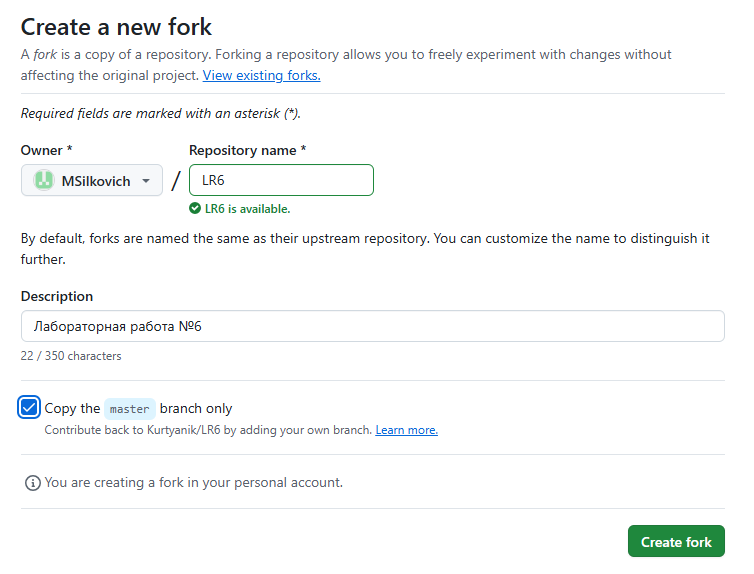
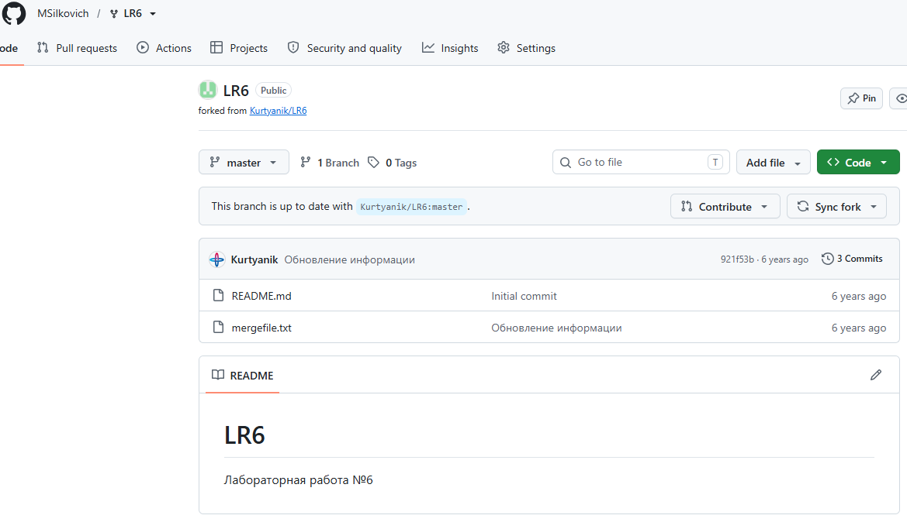

После выполнения клонирования, git был установлен на компьютер и выполнена первоначальная настройка при помощи git bash.  
Первоначальная настройка git представлена на рисунке 3.

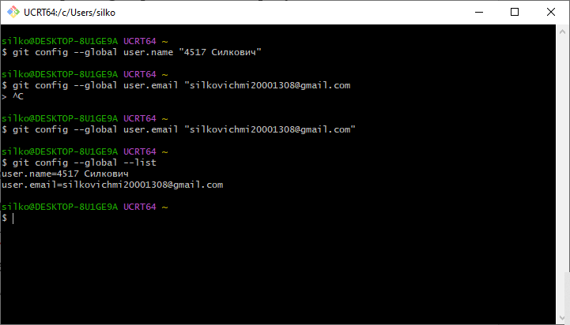

Далее форкнутый репозиторий был клонирован с удалённого репозитория на компьютер.  
На рисунке 4 представлено клонирование репозитория на компьютер.

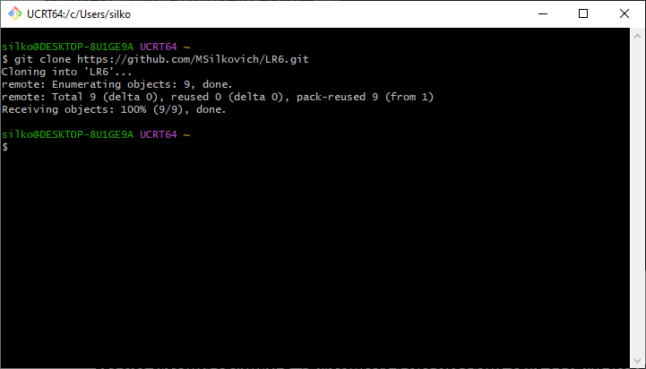

После клонирования в удалённом репозитории был создан новый файл `test.txt`, после чего изменения были подтянуты в локальный репозиторий.  
Созданный файл и его подтягивание представлены на рисунках 5–6.

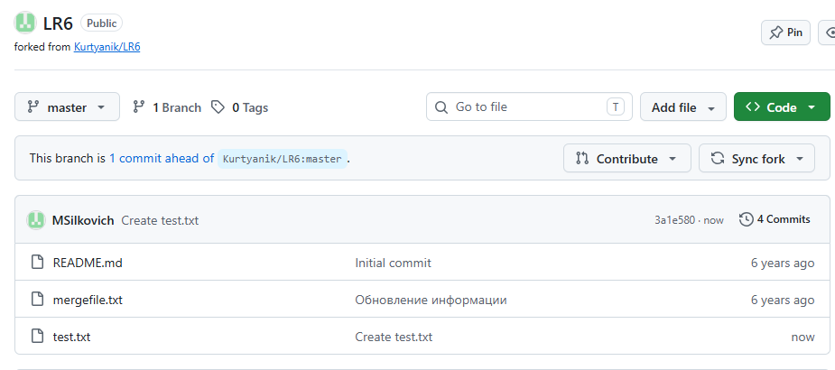
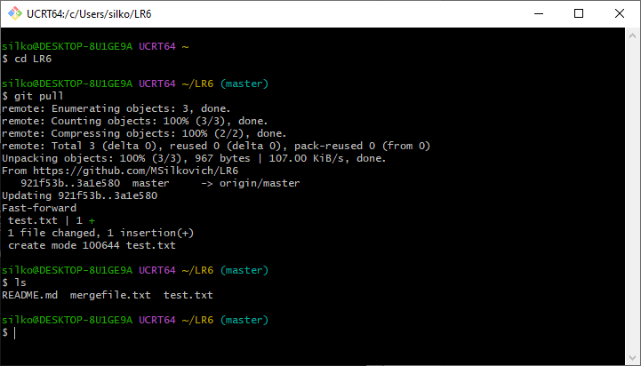

Для проверки истории изменения клеток были выполнены команды для получения списка всех ветвей, а также получена история изменений.  
Получение списка ветвей и истории изменений представлены на рисунке 7.

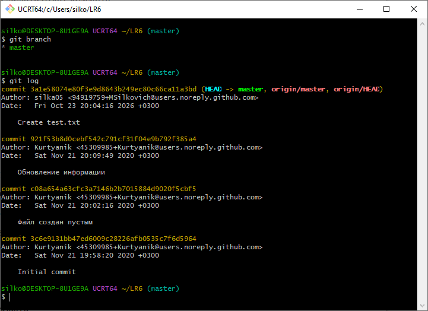

Для демонстрации слияния была создана ветвь `merge`, на которой был изменён файл `test.txt` при помощи блокнота.  
Создание ветви и редактирование файла представлено на рисунке 8.

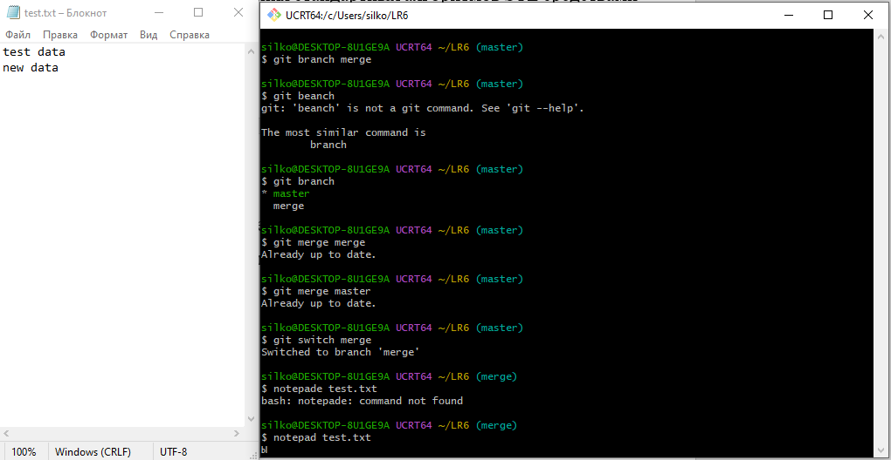

После внесения изменений был произведён commit, и таким же образом изменён файл на ветви `master`, после чего было проведено слияние в ветвь `master`. Также при слиянии был решён конфликт путём ручного изменения файла `test.txt` и завершения слияния.  
Файл `test.txt` при слиянии представлен на рисунке 9, проведение слияния — на рисунке 10.

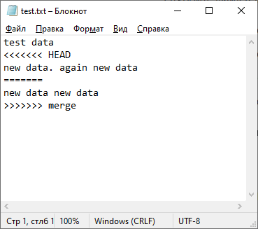
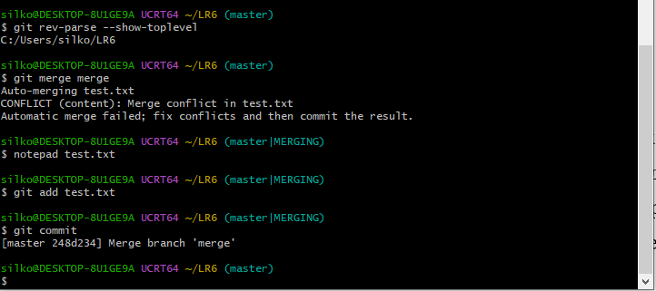

Далее была удалена дополнительная ветвь `merge`, её удаление представлено на рисунке 11.
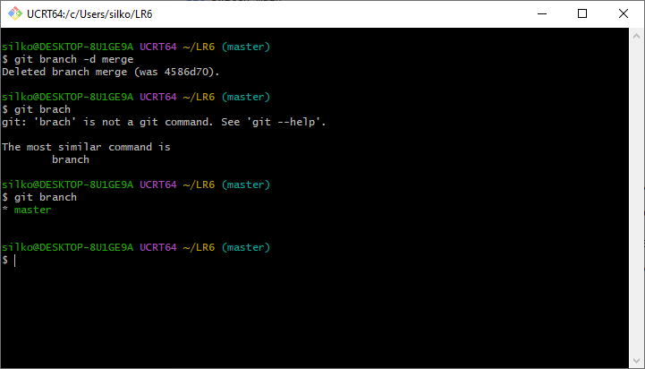

Далее были произведены 3 изменения файла `test.txt`, к каждому было добавлено сообщение.  
Внесение изменений представлено на рисунке 12.

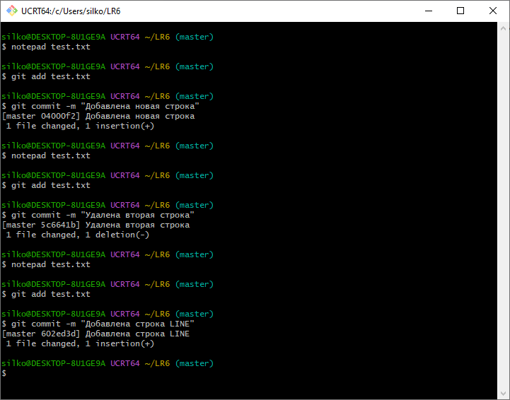

После была создана новая ветвь для отчёта, на которой была создана отдельная папка для изображений.После внесения изменений был произведён откат последнего коммита. Откат коммита и история последних 3 изменений до и после изменения представлены на рисунке 13.

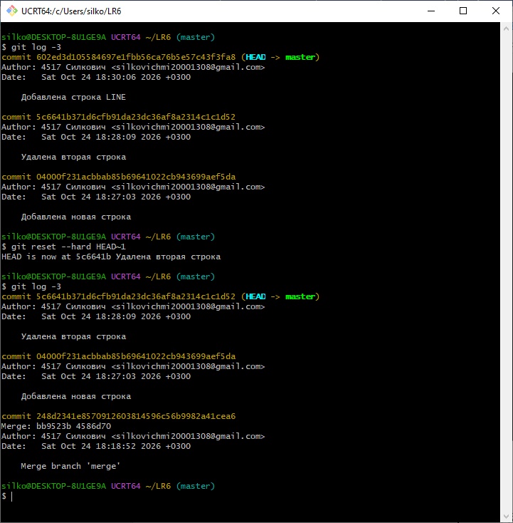

После была создана новая ветвь для отчета, на которой была создана отдельная папка для изображений, в которую были занесены рисунки для отчета. 
Создание новой ветви и папки для рисунков представлено на рисунке 14.

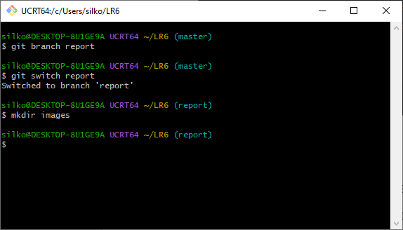

Для редактирования файла README.md был использован внутренний редактор nano, для форматирования текста и добавления изображений использован mardown.
Редактирование файла при помощи nano представлено на рисунке 15.

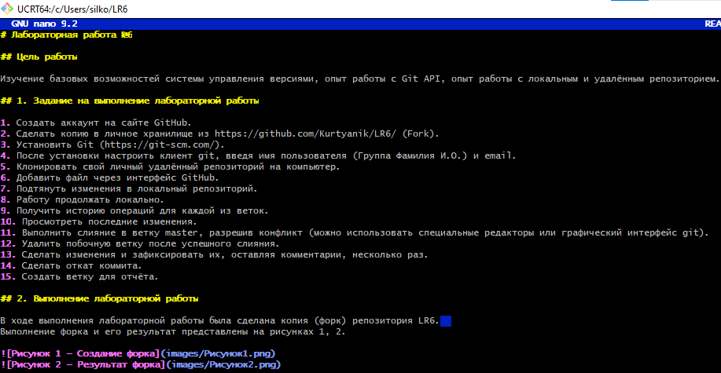

## Выводы
В ходе работы были изучены базовые возможности системы управления версиями: инициализация репозитория, коммиты, ветвление и слияние, просмотр истории. Отработаны навыки работы с локальным и удалённым репозиториями: клонирование, отправка и получение изменений, разрешение конфликтов. 
